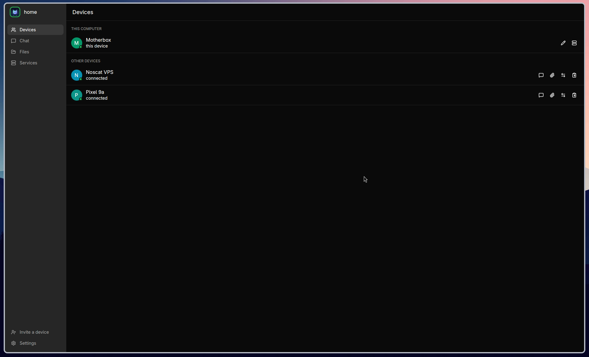

# noscat desktop

Desktop client for [noscat](https://github.com/Letdown2491/noscat), a
private device mesh on Nostr: membership is a Marmot (MLS) group on Nostr
relays, and data goes device to device over FIPS. Built with GPUI (via
gpui-kit) in pure Rust: no FFI layer, the protocol crate `noscat-client` is
embedded directly. The UI targets feature parity with the Android client
(chat, files, port forwards, joining a mesh, terminals on other computers)
plus the desktop extras (expose/serve, hosting terminals for other devices
with per-device access rules, a tray icon that keeps the device running).

<p align="center">
  
</p>

Status: early development. Released versions run noscat 0.5.0 (the
`noscat-client` crate from crates.io); 0.6 is in development against a
local noscat checkout (see Building). See [AGENTS.md](AGENTS.md) for agent
guidance.

## Joining a mesh

The app cannot create a mesh yet; a device running the noscat CLI does
that (`noscat mesh create <name>`).

1. On a device in the mesh, show its pairing code: `noscat mesh qr` on a
   CLI device, **Invite a device** in this app, or Settings > Device ID
   on Android.
2. Paste that code (or the bare `npub1...`) into the app's join screen
   and press **Request to join** (or Enter). The app sends that device a
   join request and waits up to two minutes, with a countdown; if time runs
   out, **Keep waiting** asks again.
3. Approve the request on that device: Approve on the apps' Devices tab;
   on a CLI running `noscat up` in a terminal, type the `invite npub1...`
   line it prints; on a CLI running as a service, run
   `noscat mesh requests` and answer y. The app connects by itself.

Once this computer is in the mesh, it approves join requests too: a device
that pastes or scans this computer's code shows up on the Devices tab with
Approve and Decline. Check the short device ID against the joining
device's screen before approving.

A private mesh (`noscat mesh private`, on a members-only relay such as
noscat-relay) is joined with the member's whole pairing code instead
(`noscat mesh qr` prints it: `noscat:npub1...?relay=...`); the app then
joins through that relay alone, and publishes nothing to public relays. In a private mesh, the pairing code
(Invite a device, or Settings > Show pairing code) names the mesh's relays too.

For devices on different networks to connect, one member must be reachable
from the internet (Settings > Reachable from the internet, or a server running
`noscat up --reachable`); on one LAN, devices find each other directly.

## Devices and chat

The sidebar's header names the mesh; the ring around the noscat mark is the
connection (green connected, amber connecting, red offline; hover it for
how many devices are connected). **Invite a device**, at the bottom of the
sidebar, shows this computer's pairing code as a QR, with Copy.

The Devices page lists **This computer** (with **Rename** and **Expose a
service**) and then **Other devices** by name; being online never moves a
device. Another device's row has Chat, Send a file, Forward a local port and
Share my clipboard (which shows what is on the clipboard before sending it),
and, on devices that offer one, Open a terminal; all also on right-click. Drop files on a device's row to send them to
it; the row shows the send's progress and then "Sent". A send that fails
shows a message at the bottom of the window with **Try again**. The Chat
tab shows every member on the left, latest conversation first, and the open
conversation on the right, with a divider for each day and messages from one
sender grouped; it follows new messages unless you scrolled up
to read, and files dropped on it go to that device.
A message the other device never acknowledged is marked "not delivered"
with **Try again** (sends the text again as a new message) and **Delete**;
hovering over any message shows a delete button beside it. Nothing is resent automatically,
since the other device may have received it. When this computer's network
changes (Wi-Fi to Ethernet, a hotspot, a VPN), the app notices within a few
seconds and tells noscat, so connections recover quickly.

## Terminal and access

**Open a terminal** on a device's row opens a window titled with the
device's name, running its user's shell on that device. The device may ask
its owner first ("Waiting for ... to approve"). Closing the window ends the
session. If a device refused, its terminal button dims and says why.

When another device asks for a terminal on this computer, a strip across
the top of the window (brought forward, or reopened from the tray) asks
**Allow once**, **Always allow** or **Deny**; unanswered, it is refused
after a minute. While a device has a terminal open here, a strip names it
with **End**, and the tray icon turns amber.

Settings > **Access** decides who may do what to this computer: send it
things (files, chat, clipboard), use its services, and control it
(terminals; allow, ask or block). **Everyone** sets the rule for devices
without their own; each device can have its own, and **Use the defaults**
drops them. The rules stay on this computer; no other device sees them.
Recent terminal sessions here are listed under them.

## Presence

Each device's dot says whether data can reach it: **green**, connected now;
**amber**, it is online (its announcements arrive) but nothing can connect to
it, usually because it is on another network and no member is reachable
(hover the line for what to do); **grey**, offline. For the first 45 seconds
after connecting, devices still being reached read "connecting..." in grey
rather than amber.

## Disconnect and Forget

Both sit in the Danger zone at the bottom of Settings (whose other cards are
This computer, Network, Access, Appearance and Storage). **Disconnect**
takes this computer offline but keeps it in the mesh; connect again from the
start screen. **Forget mesh** (after a confirmation) asks the other
members to remove it, then deletes its identity and mesh data here (received
files stay); to come back, join again as a new device. If no member is online,
the removal completes when one next comes online.

## Services

**Expose** passes members' connections to a service on this computer (for
example `127.0.0.1:8080`) until you press **Stop**; chat and files keep
working meanwhile. A **port forward** makes a port on this computer reach the
service another device shares: start one with **New forward** in the page
header (pick the
device and a port) or from a device row, and copy its address from the list.

## Keyboard

Ctrl+1 to Ctrl+5 switch between Devices, Chat, Files, Services and
Settings. Escape closes the open conversation, or the forward and clipboard
editors on the Devices page. Enter sends a message, saves the device name,
starts a forward and requests a join.

In a terminal window every key goes to the remote shell, Escape included;
Ctrl+Shift+V pastes and the mouse wheel scrolls back. Drag to select
(double click selects a word, triple click a line, Shift+click extends) and
Ctrl+Shift+C copies; as in other Linux terminals, a selection is also the
primary selection, which a middle click pastes.

## Layout

- `src/state.rs`: the session: owns the running `noscat_client::Client`,
  the event pump into GPUI, the roster cache, chat history, unread counts,
  and transfer state. This is the desktop counterpart of the Android app's
  `ClientHolder`.
- `src/mesh.rs`: mesh helpers (prepare, join, members, leave, wipe), the Rust-to-Rust
  counterpart of the upstream `noscat-ffi` crate's `mesh_*` functions.
- `src/views/`: one module per tab: Devices, Chat, Files, Services (expose,
  port forwards and inbound files), Settings, and the mesh join flow; plus
  the terminal window (`terminal.rs`).
- `src/state/control.rs`: terminals, access rules and access asks.
- `scripts/run.sh`: runs the built app in the dev container, for hosts
  missing a runtime library (see Running).

## Data locations

Everything lives under the XDG data dir (`~/.local/share/noscat-desktop` on
Linux):

- `device/`: this app's device: `identity.nsec` (its own noscat identity,
  mode 0600, generated on first run, separate from the CLI's so the desktop
  app is its own device), the mesh state (`mesh-state.json`,
  `relay-sync.json`) and a `lock` file (one running device per directory).
  Membership is what lets other devices reach it.
- `members.json`: the cached member list so startup renders instantly.
- `settings.json`: device name and options, including **Reachable from
  the internet** (Settings): this computer becomes the mesh's meeting point
  for devices on other networks, like `noscat up --reachable`. It binds UDP
  41641, which the router must forward to it; one reachable device per
  mesh is enough.
- `device/identity.nsec` and `device/mesh-state.json` are encrypted with a
  key kept in the desktop keyring (GNOME Keyring, KWallet, KeePassXC);
  without a keyring they stay plain, and Settings says which.
- `device/access.json`: Settings > Access, the rules for what each device
  may do to this computer (encrypted like the identity when a keyring is
  there). `device/terminal.log`: when each device opened and ended a
  terminal here.
- `chats.json`: chat history, the newest 500 messages per conversation.
  Forget mesh deletes it.
- `transfers.json`: the Files history: the last 100 sends, and the sender
  of each of the last 500 received files. Forget mesh deletes it.
- Inbound files land in `~/Downloads/noscat` (or `inbox/` under the data dir
  when Downloads is unavailable).

## Building

Plain cargo works wherever a Rust toolchain exists (on glibc Linux with the
libdbus and libclang development packages installed, which noscat's FIPS
data plane needs):

```
cargo build --release
```

On atomic (bootc) hosts there is no toolchain; build in the container like the
other noscat projects:

```
podman build -t localhost/noscat-desktop-dev -f containers/noscat-desktop-dev.containerfile containers/
podman run --rm -v noscat-desktop-cargo-home:/usr/local/cargo:z -v "$PWD:/work:Z" \
  -w /work localhost/noscat-desktop-dev sh -c "cargo check"
```

Build the binary the same way with `sh -c "cargo build --release"`.

While noscat 0.6 is in development, `Cargo.toml` builds against a noscat
checkout beside this one (`../noscat`, a temporary `[patch.crates-io]`
dropped at release). In the container, mount it there too:

```
podman run --rm -v noscat-desktop-cargo-home:/usr/local/cargo:z -v "$PWD:/work:Z" \
  -v "$PWD/../noscat:/noscat:z" -w /work localhost/noscat-desktop-dev sh -c "cargo build --release"
```

## Running

The default build is Wayland only and needs nothing beyond a normal desktop
(libxkbcommon, libxcb, Vulkan), so it runs straight from the build directory:

```
target/release/noscat-desktop
```

Xorg sessions need `cargo build --release --features x11`, which also needs
libxkbcommon-x11 at run time (a Wayland-only machine without it cannot start
that build). Releases ship both: `noscat-desktop` (Wayland) and
`noscat-desktop-x11`.

To install it for your user, with an entry in the app launcher:

```
install -Dm755 target/release/noscat-desktop ~/.local/bin/noscat-desktop
install -Dm644 assets/noscat.svg ~/.local/share/icons/hicolor/scalable/apps/noscat-desktop.svg
printf '[Desktop Entry]\nType=Application\nName=noscat\nExec=%s\nIcon=noscat-desktop\nCategories=Network;\n' \
  "$HOME/.local/bin/noscat-desktop" > ~/.local/share/applications/noscat-desktop.desktop
```

If the host lacks a runtime library, `scripts/run.sh` runs the app inside the
dev image instead (`scripts/run.sh debug` for a debug build). It passes in the
Wayland socket, session bus, GPU and fonts, uses host networking, and keeps app
data in `~/.local/share/noscat-desktop` and received files in
`~/Downloads/noscat` as a native install would. Ctrl+C quits.

## License

MIT
